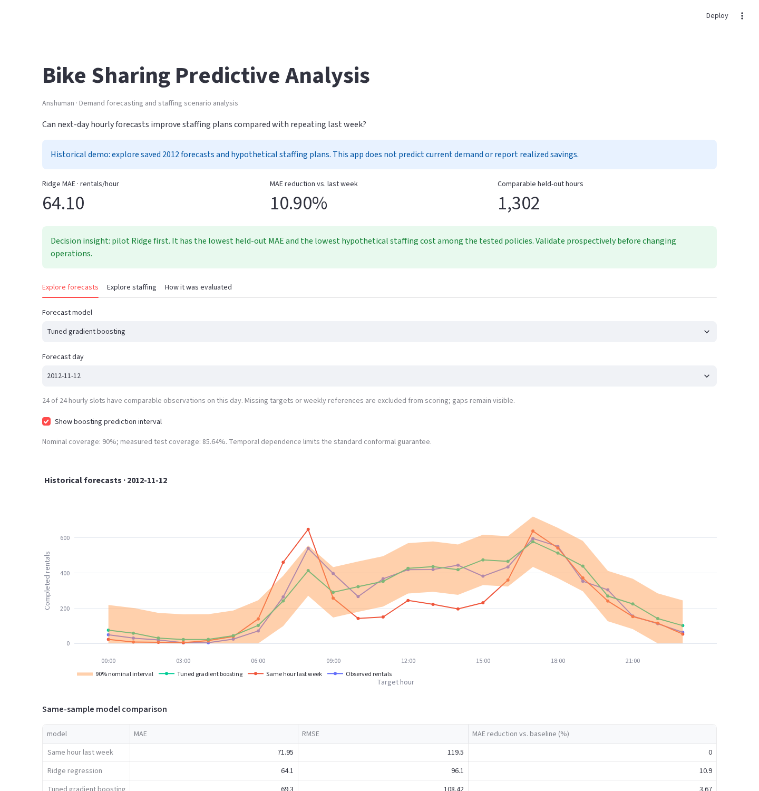

# Bike Sharing Predictive Analysis

**Anshuman · Demand forecasting and decision optimization**

**Business problem:** predict tomorrow’s hourly rentals to inform staffing plans more effectively than repeating last week’s demand.

**Current held-out result:** Ridge reduced MAE by **10.90%** on **1,302 comparable hours**. The simpler model outperformed tuned boosting. These are historical measurements, not production performance.

| Method | MAE | RMSE | MAE reduction vs. baseline |
|---|---:|---:|---:|
| Last week’s same hour | 71.95 | 119.50 | — |
| **Ridge regression** | **64.10** | **96.10** | **10.90%** |
| Tuned histogram gradient boosting | 69.30 | 108.42 | 3.67% |

Errors are completed rentals per hour; lower is better. **After modularization, the full CLI and notebook both reproduced the original metrics and predictions byte-for-byte.** Cross-validation timing fields vary; the numerical scores and selected parameters do not. Saved results were not replaced.

[Technical deep dive](docs/ARCHITECTURE.md) · [Executed analysis](analysis.ipynb) · [Engineering review](docs/TECHNICAL_REVIEW.md) · [Google Colab](https://colab.research.google.com/github/agrawalanshuman/Bike_Sharing_Predictive_Analysis/blob/main/analysis.ipynb)

## Run the historical demo

From a clone of this repository, using **Python 3.12**:

```bash
python -m venv .venv
source .venv/bin/activate
python -m pip install -r requirements.txt
python -m streamlit run bike_sharing.py
```

Open the local URL printed by Streamlit, normally `http://localhost:8501`. On Windows, activate with `.venv\Scripts\activate`. Windows has not been independently tested.

Select a historical date and model to compare forecasts with observed rentals and the weekly baseline, inspect boosting interval coverage, download scored forecasts, and explore saved staffing scenarios. **The viewer requires no Gurobi package or license.** It validates the saved files before displaying metrics and does not train models, solve new plans, or forecast current demand.



## What the results mean

- **Decision:** pilot Ridge first, subject to prospective validation. It has the lowest held-out MAE and the lowest simulated staffing cost among the tested policies.
- **Uncertainty:** boosting’s 90% nominal MAPIE intervals achieved **85.64% coverage**, with mean width **251.42 rentals**. Temporal dependence and drift limit standard conformal guarantees.
- **Scope:** completed rentals do not measure unmet demand, station inventory, or unique bicycles required. This project cannot justify a claim that a particular station needs a specific number of extra bikes.
- **Operational limits:** the historical test covers autumn/winter only. Reporting latency, throughput, staffing rules and costs require validation with an operator. SHAP explains predictions, not causal effects.
- **Deployment:** this is a local historical research demo. No public deployment or realized operating savings are claimed. Hosted Colab and Streamlit remain unverified.

## Data and evaluation

Source: [UCI Bike Sharing Dataset](https://archive.ics.uci.edu/dataset/275/bike+sharing+dataset), Capital Bikeshare, 2011–2012: **17,379 observed hourly rows**. The original CSV is checksum-verified; its full hourly grid exposes **165 missing hours**, which remain missing. See [data provenance and CC BY 4.0 attribution](data/README.md).

| Period | Dates | Purpose |
|---|---|---|
| Training | January 8, 2011, 23:00–October 7, 2012, 23:00 | Fit preprocessing and models; tune boosting within chronological training folds |
| Calibration | October 8–November 4, 2012 | Calibrate intervals on 636 observed targets |
| Held-out testing | November 5–December 30, 2012 | Compare all methods on the final eight complete Monday–Sunday weeks |

There is **no random train/test split**. Each forecast issues at 11:59 PM for the next calendar day’s 24 hours. Features use known calendar information, exact 24/48/168-hour lags, and rolling history ending at least 24 hours before the target. Fitted models remain frozen; lags refresh only after observations become available. Missing features are imputed inside training-only pipelines.

`casual` and `registered` are excluded because they compose the target. Contemporaneous observed weather and future target values are excluded from forecast inputs. Observed weather is used only for retrospective error diagnostics. Four missing actuals and 38 missing weekly references reduce the 1,344 scheduled test hours to the common 1,302-hour comparison sample; the incomplete terminal week is excluded.

## Staffing simulations with Gurobi

Six four-hour shifts, 0–20 assignments per shift, at most 48 worker-shift assignments per day. Assumptions: 40 rental-service units per worker-hour, USD 20 hourly wage, USD 5 shortage-unit penalty and USD 1 excess-unit penalty. Only forecasts enter optimization; actuals evaluate the frozen plans afterward.

| Policy | Simulated cost over 48 complete days / 1,152 hours |
|---|---:|
| Fixed eight assignments per shift | $546,974 |
| Gurobi + weekly baseline | $401,486 |
| Gurobi + Ridge | **$372,872** |
| Gurobi + boosting | $380,462 |

All **144 model-based solves** attained certified optimality. These are hypothetical retrospective simulations, designed after forecast test scores were known—not measured savings or a fresh policy holdout. Worker-shift assignments are not unique employees or station-level bicycle allocations. Nine penalty scenarios revalue the same plans. [Optimization formulation and limitations](docs/ARCHITECTURE.md#optimization-contract).

The older point-capacity scenario remains preserved separately in `results/costs.csv`; its different sample and cost definition should not be compared directly with staffing totals.

## Reproduce and test

**Without a solver license**—install test dependencies and run the core suite, including deterministic boosting reproduction and the dashboard:

```bash
python -m pip install -r requirements-dev.txt
python -m pytest -m "not gurobi"
python bike_sharing.py --verify
```

**37 tests passed** in a fresh environment with no `gurobipy` installed. Use `-m "not gurobi and not slow"` for the 36-test quick suite. The CI workflow installs these dependencies, proves the solver is absent, runs the 37 tests, verifies saved artifacts, and checks for unintended file changes. It has no deployment step.

**Optional Gurobi workflow**—requires the solver package and a usable license:

```bash
python -m pip install -r requirements-dev.txt -r requirements-gurobi.txt
python -m pytest -m gurobi
python bike_sharing.py --data-file data/hour.csv --output-dir run_outputs
```

Four optional solver tests passed locally, including comparison with exhaustive enumeration. The full run also reproduced all 144 solves. Gurobi has separate proprietary license terms; small-model success here does not establish license availability elsewhere. Keep credentials outside Git. [Gurobi support](https://support.gurobi.com/).

Default analysis outputs go into ignored `run_outputs/`. Test and verification commands are read-only unless given a new `--report-file` path. The familiar `--self-test` and `--test-demo` CLI actions now dispatch to pytest; add `--with-gurobi` to `--self-test` to include solver checks. Notebook refresh and document-generation actions intentionally write artifacts; use a separate checkout for those. Colab installs the optional solver requirements for the full notebook, but hosted execution has not been verified.

## Architecture and portfolio evidence

`bike_sharing.py` is the compatibility entry point. Implementation is separated into testable modules under [`bike_share/`](bike_share/): data loading, input contracts, features/splits, forecasting, evaluation, optimization, plotting, artifact reconciliation, optional documents, notebook execution and dashboard orchestration. Existing notebook imports remain supported. Tests live under [`tests/`](tests/).

| Career direction | Demonstrated evidence |
|---|---|
| Applied AI Engineer | Reusable forecast function, input contracts, module boundaries, automated tests and historical UI |
| Data Scientist | Seasonal benchmark, chronological evaluation, tuning, calibration, SHAP and sliced errors |
| Data Engineer | Source integrity, explicit hourly data contracts, missingness handling and cross-file reconciliation |
| Supply Chain Analytics Consultant | Forecast-to-capacity decisions, integer optimization, cost assumptions and sensitivity analysis |

SQL, Databricks and SAP are relevant background for future integrations; they are not implemented in this repository. There is no HTTP inference service or production monitoring system.

## Demo benchmark

A single local Chromium client measured **5.471 seconds to the first forecast chart** after navigation to an already-running server. Five historical-date changes took **0.958 seconds median**, **1.546 seconds maximum**. The flow also verified baseline comparison, interval coverage, staffing selection, CSV download and mobile layout, with no page JavaScript errors. These are local observations, not a production SLA or concurrent-load benchmark.

[Measured samples and environment](docs/demo_benchmark.json) · [Reproduce the browser flow](docs/ARCHITECTURE.md#browser-benchmark).

## Authorship, licensing and AI assistance

**Author: Anshuman.** I used **OpenAI Codex to debug code and resolve implementation issues**, with additional assistance on implementation, tests, analysis, visualizations and documentation. I am responsible for reviewing and explaining the methods and conclusions. Reported results come from executed code and preserved evidence.

Data: Fanaee-T and Gama (2013), *Event labeling combining ensemble detectors and background knowledge*, [DOI: 10.1007/s13748-013-0040-3](https://doi.org/10.1007/s13748-013-0040-3), distributed by UCI under CC BY 4.0. Gurobi is separately licensed. No source-code license has been selected; public visibility alone does not grant an open-source license. Credential files, including `.streamlit/secrets.toml`, are ignored. Use no proprietary employer data in this public demo.
