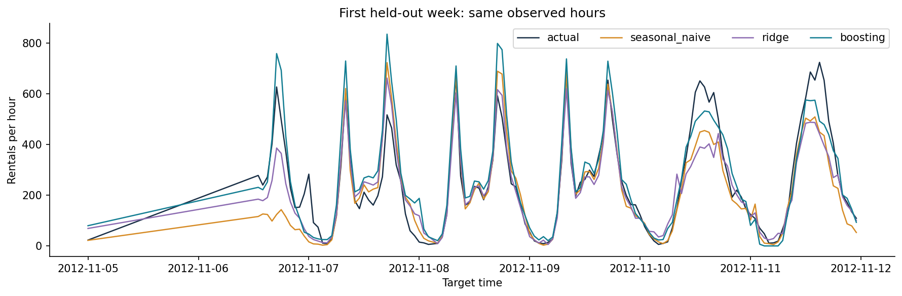

# Bike Sharing Predictive Analysis

**Anshuman · Next-day hourly demand forecasting**

[Open in Google Colab](https://colab.research.google.com/github/agrawalanshuman/Bike_Sharing_Predictive_Analysis/blob/main/open_in_colab.ipynb) · [Read the analysis](analysis.ipynb) · [Business memo](reports/memo.pdf) · [Presentation](reports/presentation.pdf)

A reproducible forecasting project that asks whether machine learning can improve the next day's system-wide bike-sharing capacity plan. At 11:59 PM, the workflow predicts each of the following day's 24 hourly rental counts using information available before issuance. The intended decision-maker is a hypothetical operations manager reviewing aggregate service capacity and staffing.

The project uses real Capital Bikeshare observations, a same-hour-last-week benchmark, chronological validation, prediction intervals and local explanations. It is a personal portfolio project developed by Anshuman with an accompanying [ISOM 835 assessment map](coursework/README.md).

## Findings

On **1,302 comparable held-out hours**, Ridge regression outperformed both the seasonal benchmark and tuned gradient boosting. MAE and RMSE are in rentals per hour; lower is better.

| Method | MAE | RMSE | MAE reduction vs. baseline |
|---|---:|---:|---:|
| Same hour last week | 71.95 | 119.50 | — |
| **Ridge regression** | **64.10** | **96.10** | **10.90%** |
| Tuned histogram gradient boosting | 69.30 | 108.42 | 3.67% |

The more complex model did not achieve the best predictive accuracy. Ridge is the leading candidate for a prospective pilot, with seasonal naive retained as a reference. The comparison describes these held-out weeks; it does not establish future performance.

The boosting model's MAPIE intervals targeted 90% coverage and achieved **85.64% empirical coverage**, with an average width of **251.42 rentals**. This shortfall matters: temporal dependence and changing demand undermine the exchangeability assumptions behind standard conformal guarantees.

For the fixed planning rule `ceil(max(0, forecast))`, assumed costs of **$5 per underplanned rental-unit** and **$1 per excess unit** produce baseline proxy cost of **$230,005** and boosting proxy cost of **$133,389** across the common test sample. The **$96,616 difference is a hypothetical scenario**, not measured operating savings or evidence of a causal effect. Nine combinations of assumed shortage and excess costs are reported. This requested baseline-versus-boosting comparison does not establish that boosting is the best operational policy.



*First held-out week: the same observed hours for the baseline, Ridge and boosting forecasts.*

## Data and validation

The [UCI Bike Sharing Dataset](https://archive.ics.uci.edu/dataset/275/bike+sharing+dataset) contains **17,379 observed hourly records** from 2011–2012. Creating a complete hourly grid exposes **165 missing hours**. Missing targets remain missing; no rental observations are fabricated.

| Period | Dates | Use |
|---|---|---|
| Proper training | January 8, 2011, 23:00–October 7, 2012, 23:00 | Fit preprocessing and models; tune boosting within chronological training folds |
| Calibration | October 8–November 4, 2012 | Calibrate intervals using 636 observed targets |
| Held-out testing | November 5–December 30, 2012 | Compare forecasts on the last eight complete Monday–Sunday weeks |

The test schedule contains 1,344 hours. Four lack an observed target and another 38 lack the exact same-hour-last-week observation, leaving the shared 1,302-hour comparison sample. December 31 belongs to an incomplete terminal week and is excluded. These exclusions limit the population represented by the reported metrics.

Features are derived calendar information, exact 24/48/168-hour demand lags, and seven-day rolling mean, maximum and observation count. Rolling windows cover `[target − 191 hours, target − 24 hours]`. Calendar interactions and cyclic hour features capture commuting patterns. Missing feature values are imputed inside training-only pipelines.

The target components `casual` and `registered` are excluded. Actual target-hour weather is also excluded because no historical weather-forecast archive is available. Observed weather is used only to describe errors after forecasts have been made. Forecast parameters remain frozen through testing; past test-day counts may update tomorrow's features only after those counts have been observed. This is daily rolling-origin evaluation.

## One Python file

[`bike_sharing.py`](bike_sharing.py) contains the entire implementation: source loading, feature generation, preprocessing pipelines, model tuning, scoring, MAPIE intervals, three SHAP waterfalls, sliced errors, capacity-cost sensitivity, figures, PDFs, notebook execution and validation checks. There are no additional project Python modules.

The executed [`analysis.ipynb`](analysis.ipynb) tells the full analytical story. The two notebooks under [`coursework/`](coursework/) retain the staged baseline and advanced-model deliverables. They call the same implementation to keep the methods consistent.

## Run the project

The project is tested with **Python 3.12** on CPU. Pinned direct and transitive dependencies are listed in [`requirements.txt`](requirements.txt). No API keys or external services are required.

```bash
python -m venv .venv
source .venv/bin/activate
python -m pip install -r requirements.txt
python bike_sharing.py --self-test
python bike_sharing.py
```

The default run recomputes the analysis and writes fresh outputs under `run_outputs/`. The saved portfolio results remain in `results/`, `visualizations/` and `reports/`. To choose an output location or provide the original data explicitly:

```bash
python bike_sharing.py --data-file data/hour.csv --output-dir run_outputs
```

The loader uses the supplied real source file or downloads the checksum-verified UCI data. It never substitutes synthetic observations. The fixed random seed is 835 wherever randomness applies.

To refresh the executed notebooks and presentation documents from the repository root, then verify the saved artifacts:

```bash
python bike_sharing.py --execute-notebooks
python bike_sharing.py --build-documents --output-dir .
python bike_sharing.py --verify
```

The 13 safety checks cover exact timestamp lags, historical rolling windows, target-day perturbations, excluded leakage columns, chronological separation, missing targets, training-only preprocessing and the 24-hour forecasting API. Artifact checks validate notebook outputs and consistency of exported results. PDF page limits are checked with the pinned `pypdf` dependency.

### Google Colab

Open the [Colab launcher](https://colab.research.google.com/github/agrawalanshuman/Bike_Sharing_Predictive_Analysis/blob/main/open_in_colab.ipynb) and run its cells in order: install dependencies, execute the Python file, display figures, and optionally download the outputs. A Git clone and Google Drive mount are unnecessary. If conflicting packages were already imported, restart the runtime after installation.

The standalone workflow is validated locally. Execution inside Google's hosted Colab service has not been independently verified.

## Repository guide

| Location | Contents |
|---|---|
| `bike_sharing.py` | Sole Python source file and command-line interface |
| `analysis.ipynb` | Executed integrated analysis with visible results |
| `open_in_colab.ipynb` | Interactive Colab launcher |
| `data/` | Original hourly source data and attribution |
| `results/` | Predictions, metrics, tuning results, intervals, slices and SHAP values |
| `visualizations/` | Forecast, residual, interval, explanation and business-analysis figures |
| `reports/` | Two-page decision memo, ten-slide presentation and model card |
| `coursework/` | Assessment mapping, milestone notebooks and original discussion materials |

## Interpretation and limitations

Observed counts measure completed rental trips. Customers unable to rent a bike or find a dock are not recorded as unmet demand. Aggregate trips also do not reveal station inventories or the number of unique bicycles needed. The project supports system-wide planning research; it cannot allocate bicycles to individual stations.

The analysis assumes hourly counts are finalized by the prior day's 11:59 PM issue time and calendar information is known. Reporting delays would require longer lags. Weather shocks, special events, missing history and trend changes remain failure modes. The test period covers autumn and winter only. SHAP explains the fitted model's predictions rather than causal effects. Before operational use, validate the policy prospectively, confirm data latency and planning constraints, and monitor error, missingness and interval coverage.

## Authorship and attribution

**Author: Anshuman.** OpenAI Codex assisted with implementation, debugging, documentation, figures and drafting. Anshuman is responsible for reviewing and explaining the methods, assumptions and conclusions. The project has not been deployed; no class submission or peer-discussion participation is claimed.

Data citation: Fanaee-T, Hadi, and João Gama (2013), *Event labeling combining ensemble detectors and background knowledge*, Progress in Artificial Intelligence. DOI: [10.1007/s13748-013-0040-3](https://doi.org/10.1007/s13748-013-0040-3). See [`data/README.md`](data/README.md) for source provenance and checksum. Learning-resource attribution and the assessment checklist are recorded in [`coursework/README.md`](coursework/README.md); copied lecture files are not distributed in this repository.
