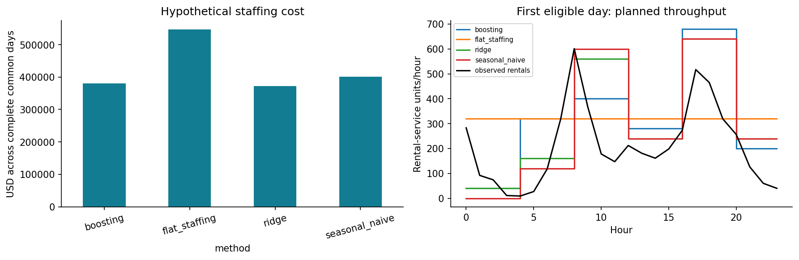

# Bike Sharing Predictive Analysis

**Anshuman · Personal data science portfolio**

**Business problem:** forecast tomorrow’s hourly bike rentals to inform staffing plans more effectively than repeating last week’s demand.


**Held-out results · 1,302 comparable hours · errors in rentals/hour (lower is better)**

| Method | MAE | RMSE | MAE reduction vs. baseline |
|---|---:|---:|---:|
| Same hour last week | 71.95 | 119.50 | — |
| **Ridge regression** | **64.10** | **96.10** | **10.90%** |
| Tuned histogram gradient boosting | 69.30 | 108.42 | 3.67% |

**Run with Python 3.12** (inside the cloned repository; a virtual environment is recommended):

```bash
python -m pip install -r requirements.txt
python -m streamlit run bike_sharing.py  # interactive historical demo
# Or reproduce the complete analysis: python bike_sharing.py
```

The demo displays saved outputs and needs no solver license. Recomputing the analysis requires a usable Gurobi license.

**Time-based split:** fit through October 7, 2012 → calibrate October 8–November 4 → test November 5–December 30. Tuning and preprocessing use training data only; no random train/test split.

**Decision insight:** pilot Ridge first. It reduced MAE by **10.90%** versus last week’s same hour and had the lowest hypothetical staffing cost among the tested policies. Validate it prospectively before changing staffing; these data cannot estimate extra bikes needed at individual stations.

[Interactive demo setup](#interactive-demo) · [Full analysis](analysis.ipynb) · [Open in Google Colab](https://colab.research.google.com/github/agrawalanshuman/Bike_Sharing_Predictive_Analysis/blob/main/analysis.ipynb)

## Findings and interpretation

The more complex model did not achieve the best predictive accuracy. Ridge is the leading candidate for a prospective pilot, with seasonal naive retained as a reference. The comparison describes these held-out weeks; it does not establish future performance.

The boosting model's MAPIE intervals targeted 90% coverage and achieved **85.64% empirical coverage**, with an average width of **251.42 rentals**. This shortfall matters: temporal dependence and changing demand undermine the exchangeability assumptions behind standard conformal guarantees.

For the fixed planning rule `ceil(max(0, forecast))`, assumed costs of **$5 per underplanned rental-unit** and **$1 per excess unit** produce baseline proxy cost of **$230,005** and boosting proxy cost of **$133,389** across the common test sample. The **$96,616 difference is a hypothetical scenario**, not measured operating savings or evidence of a causal effect. Nine combinations of assumed shortage and excess costs are reported. This baseline-versus-boosting comparison does not establish that boosting is the best operational policy.

## Data and validation

The [UCI Bike Sharing Dataset](https://archive.ics.uci.edu/dataset/275/bike+sharing+dataset) contains **17,379 observed hourly records** from 2011–2012. Creating a complete hourly grid exposes **165 missing hours**. Missing targets remain missing; no rental observations are fabricated.

| Period | Dates | Use |
|---|---|---|
| Proper training | January 8, 2011, 23:00–October 7, 2012, 23:00 | Fit preprocessing and models; tune boosting within chronological training folds |
| Calibration | October 8–November 4, 2012 | Calibrate intervals using 636 observed targets |
| Held-out testing | November 5–December 30, 2012 | Compare forecasts on the last eight complete Monday–Sunday weeks |

The test schedule contains 1,344 hours. Four lack an observed target and another 38 lack the exact same-hour-last-week observation, leaving the shared 1,302-hour comparison sample. December 31 belongs to an incomplete terminal week and is excluded. These exclusions limit the population represented by the reported metrics.

Features are derived calendar information, exact 24/48/168-hour demand lags, and seven-day rolling mean, maximum and observation count. Rolling windows cover `[target − 191 hours, target − 24 hours]`. Calendar interactions and cyclic hour features capture commuting patterns. Missing feature values are imputed inside training-only pipelines.

The target components `casual` and `registered` are excluded. Actual target-hour weather is also excluded because no historical weather-forecast archive is available. Observed weather is used only to describe errors after forecasts have been made. Forecast parameters remain frozen through testing; past test-day counts may update tomorrow's features only after those counts have been observed. This is daily rolling-origin evaluation.

## Forecasts to decisions: Gurobi optimization

The project uses **gurobipy 13.0.3** to select integer staffing assignments and **Plotly 7.1.0**
to explore daily planning costs interactively. Forecast quality and planning outcomes are evaluated separately.

For each next day, six nonoverlapping four-hour shifts start at 00:00, 04:00, 08:00, 12:00, 16:00
and 20:00. Gurobi chooses 0–20 assignments per shift with at most 48 assignments per day
(192 worker-hours). These are worker-shift assignments, not a count of unique employees.
Assume 40 rental-service units per worker-hour, USD 20 hourly wages, USD 5 per shortage-unit and
USD 1 per excess unit. The objective minimizes wages plus forecast shortage/excess penalties.
Only forecasts and these fixed assumptions enter the solver; actuals evaluate the resulting plan afterward.
This is aggregate throughput planning, not station allocation or a labor-compliant individual roster.

| Planning method | Actual-evaluated hypothetical cost |
|---|---:|
| Fixed eight assignments per shift | $546,974 |
| Gurobi + seasonal-naive forecast | $401,486 |
| Gurobi + Ridge forecast | **$372,872** |
| Gurobi + boosting forecast | $380,462 |

All **144 solves** attained certified optimality. The comparison uses **48 complete common days /
1,152 hours**; eight partial days are excluded equally. Each model has 54 variables (six integer)
and 25 constraints. Status, objective, bound, assignments and evaluated costs are exported in `results/staffing_*`.
The nine-scenario sensitivity table revalues the same frozen plans under different assumed penalties;
it does not optimize against test actuals. These costs include wages and use a different sample from
the original point-capacity analysis, so the two cost totals should not be compared directly.

This extension was designed after the forecast test scores were known. It is exploratory retrospective
analysis, not an untouched policy holdout or evidence of causal savings. Throughput, wages, budgets,
shift lengths and labor constraints must be validated with an operator before any deployment.
Ridge remains the leading candidate for prospective validation.



Download and open [`staffing_interactive.html`](visualizations/staffing_interactive.html) in a browser
for the Plotly report (GitHub displays the file rather than running it). JavaScript is included for offline use.

### Gurobi licensing

`requirements.txt` installs gurobipy and Plotly. A usable Gurobi license is required in the execution
environment. The available local license successfully solved these small models; Google-hosted Colab
licensing has not been independently tested. If Gurobi reports a license error, configure an appropriate
license using Gurobi's official instructions: https://support.gurobi.com/.
Keep any credentials outside the repository and notebooks. The workflow raises an explicit error if
licensing fails or optimality is not certified; it does not silently replace Gurobi or fabricate results.

## Skills demonstrated

| Data science capability | Evidence in this project |
|---|---|
| Business problem framing | Translate next-day rental forecasts into an explicit staffing decision with measurable cost assumptions |
| Data auditing with pandas and NumPy | Validate source integrity, reconstruct the hourly timeline, identify missing observations, and prevent target leakage |
| Time-series feature engineering | Build timestamp-aligned demand lags, historical rolling windows, calendar features, and commute interactions |
| Machine learning with scikit-learn | Compare a seasonal benchmark, Ridge regression, and tuned histogram gradient boosting using training-only pipelines |
| Experiment design and evaluation | Use chronological validation, a separate calibration period, common scoring samples, MAE/RMSE, and error slices |
| Model interpretation and uncertainty | Explain individual predictions with SHAP and measure MAPIE interval coverage rather than assuming nominal coverage |
| Operations research with gurobipy | Formulate integer staffing decisions, enforce capacity and budget constraints, and verify solver optimality |
| Visualization and communication | Present Matplotlib diagnostics, Plotly charts, a Streamlit demo, and optional model-card and report exports |
| Reproducible Python development | Package the workflow in one Python file with pinned dependencies, 27 automated core checks and four demo tests, and artifact verification |

## What this project can be used for

- **Portfolio and technical interviews:** walk through a complete forecasting-to-decision workflow, explain leakage prevention, and discuss why the simpler model performed best.
- **Demand-planning research:** explore hourly demand patterns and compare next-day forecasts against an interpretable seasonal benchmark.
- **Staffing scenario analysis:** vary explicit operational assumptions and examine forecast-driven staffing costs before considering a prospective pilot.
- **A reusable project pattern:** adapt the chronological evaluation, uncertainty analysis, and constrained planning workflow to other hourly demand datasets after validating their data availability and operating constraints.

The outputs support research and scenario planning. Real operational use requires current data, validated throughput and cost assumptions, and prospective evaluation; historical scenario costs are not realized savings.

## One Python file

[`bike_sharing.py`](bike_sharing.py) contains the entire implementation: source loading, feature generation, preprocessing pipelines, model tuning, scoring, MAPIE intervals, three SHAP waterfalls, sliced errors, capacity-cost sensitivity, figures, PDFs, Gurobi shift optimization, Plotly interactive reporting, the Streamlit demo, notebook execution and validation checks. There are no additional project Python modules.

The executed [`analysis.ipynb`](analysis.ipynb) tells the full analytical story, from the first baseline through advanced modeling and optimization. It calls the same Python implementation used by the command-line workflow.

## Run the project

The project is tested with **Python 3.12** on CPU. Pinned direct and transitive dependencies are listed in [`requirements.txt`](requirements.txt). No data API keys are required; Gurobi needs an available license, as described above.

```bash
python -m venv .venv
source .venv/bin/activate
python -m pip install -r requirements.txt
python bike_sharing.py --self-test
python bike_sharing.py --test-demo
python bike_sharing.py --verify
python bike_sharing.py
```

**Checks are read-only by default.** `--self-test`, `--test-demo`, and `--verify` do not rewrite the historical JSON evidence in `results/`. Use `--report-file run_outputs/review/checks.json` with one of those actions to save a new report; choose a new filename for each run. Do not use Python `-O` for checks. `--data-file` explicitly selects a local source and fails on a missing or altered file; automatic download is used only when no explicit path is given.

The default run recomputes the analysis and writes fresh outputs under `run_outputs/`. The saved portfolio results remain in `results/` and `visualizations/`. Reports can be generated locally on demand. To choose an output location or provide the original data explicitly:

```bash
python bike_sharing.py --data-file data/hour.csv --output-dir run_outputs
```

The loader uses the supplied real source file or downloads the checksum-verified UCI data. It never substitutes synthetic observations. The fixed random seed is 835 wherever randomness applies.

**Rebuilding is different from checking:** the following notebook/document commands intentionally regenerate local artifacts. Run them in a separate checkout when you want to preserve the saved experiment. To refresh from the repository root:

```bash
python bike_sharing.py --execute-notebooks
python bike_sharing.py --build-documents --output-dir .
python bike_sharing.py --verify
```

The 27 core checks cover exact timestamp lags, historical rolling windows, target-day perturbations, excluded leakage columns, chronological separation, missing targets, training-only preprocessing and the 24-hour forecasting API. Four optimization checks cover brute-force objective agreement, feasibility and cost arithmetic, forecast-only inputs with zero demand, and invalid-input rejection. Ten additional regression checks reject malformed time grids, invalid inputs, inconsistent artifacts, mislabeled solver errors, and tests run with assertions disabled. Four separate Streamlit tests exercise selections, missing-hour display, cost accuracy, invalid artifacts, and viewing without a solver license. Artifact checks reconcile timestamps and actuals with the audited source, verify complete policy/shift keys, and recompute saved cost components and sensitivity tables. When optional PDFs are present, their two-page memo and ten-slide presentation formats are checked with the pinned `pypdf` dependency.

## Interactive demo

Run `python -m streamlit run bike_sharing.py` (or `python bike_sharing.py --demo`) and open the local URL shown in your terminal, normally `http://localhost:8501`.

- Select a model and test date to compare forecasts with observed rentals and last week’s same hour.
- Inspect boosting prediction intervals, including their measured coverage shortfall.
- Explore saved Gurobi shift assignments and hypothetical costs for 48 complete days.
- Download a selected day’s scored forecasts and review the chronological evaluation design.

This is an interactive viewer of saved historical results. It does not train models, solve new plans, or forecast current demand, so viewing it needs no Gurobi license. Missing scored hours remain gaps. All application and analysis code stays in **one Python file**.

**Public hosting:** the app has been tested locally, but no public demo URL is deployed yet. To publish through [Streamlit Community Cloud](https://share.streamlit.io/), connect your GitHub account, create an app from `agrawalanshuman/Bike_Sharing_Predictive_Analysis`, choose branch `main`, set the entry point to `bike_sharing.py`, and select Python 3.12. Dependencies come from `requirements.txt`; no data credentials or solver license are needed for the viewer. After successful deployment, add its actual URL to this README and your LinkedIn post.

### Google Colab

Open the [analysis notebook in Colab](https://colab.research.google.com/github/agrawalanshuman/Bike_Sharing_Predictive_Analysis/blob/main/analysis.ipynb) and run the cells in order. Its first code cell clones the public repository and installs the pinned dependencies when running in Colab. The notebook uses the same `bike_sharing.py` implementation as the local workflow; no separate launcher or Google Drive mount is needed. If packages were already imported before installation, restart the runtime and rerun the cells. A compatible Python runtime and a usable Gurobi license are required.

The standalone workflow is validated locally. Execution inside Google's hosted Colab service has not been independently verified.

## Architecture and role relevance

The CLI and notebook use the same implementation: **audited CSV → hourly features → chronological model fitting/calibration → held-out forecasts → Gurobi scenarios → saved results → historical demo**. The viewer validates saved artifacts against the public source before displaying metrics. It fits no model and starts no solver.

| Career direction | Evidence you can discuss | Boundary |
|---|---|---|
| Applied AI Engineer | Reusable forecast function, validated inputs, tested model-to-decision workflow, interactive interface, CI checks | A batch research workflow; no model-serving API, production deployment, or LLM application |
| Data Scientist | Baselines, leakage prevention, temporal validation, tuning, calibration, SHAP, and sliced errors | One historical dataset and seasonal test window; future accuracy remains unverified |
| Data Engineer | Source checksum, hourly data contract, explicit missingness, reproducible exports, and cross-file reconciliation | Local pandas processing; no SQL warehouse, Spark/Databricks pipeline, or SAP integration |
| Supply Chain Analytics Consultant | Demand-to-capacity formulation, integer decisions, solver certificates, asymmetric costs and sensitivity analysis | Hypothetical system-wide throughput; no station allocation or validated operating savings |

SQL, Databricks, and SAP are relevant background for future integrations, not implemented project features. The [technical review](docs/TECHNICAL_REVIEW.md) records the baseline inventory, prioritized plan, confirmed results, assumptions, commands, and remaining work. The [CI workflow](.github/workflows/validate.yml) runs core tests, artifact checks and demo tests; it does not deploy the application.

## Repository guide

| Location | Contents |
|---|---|
| `bike_sharing.py` | Sole Python source file, command-line interface, demo and embedded tests |
| `.github/workflows/validate.yml` | Python 3.12 verification workflow with read-only repository permissions |
| `docs/TECHNICAL_REVIEW.md` | Engineering review, evidence and implementation limitations |
| `analysis.ipynb` | Executed integrated analysis with visible results |
| `data/` | Original hourly source data and attribution |
| `results/` | Predictions, metrics, tuning results, intervals, slices and SHAP values |
| `visualizations/` | Forecast, residual, interval, explanation and business-analysis figures |
| `reports/` (generated locally) | Optional decision memo, presentation and model card exports |

## Interpretation and limitations

Observed counts measure completed rental trips. Customers unable to rent a bike or find a dock are not recorded as unmet demand. Aggregate trips also do not reveal station inventories or the number of unique bicycles needed. The project supports system-wide planning research; it cannot allocate bicycles to individual stations.

The analysis assumes hourly counts are finalized by the prior day's 11:59 PM issue time and calendar information is known. Reporting delays would require longer lags. Weather shocks, special events, missing history and trend changes remain failure modes. The test period covers autumn and winter only. SHAP explains the fitted model's predictions rather than causal effects. Before operational use, validate the policy prospectively, confirm data latency and planning constraints, and monitor error, missingness and interval coverage.

## Licensing and security

The UCI dataset is distributed under [CC BY 4.0](https://creativecommons.org/licenses/by/4.0/); preserve its attribution when reusing it. Gurobi has separate proprietary license terms. This repository currently has **no source-code license**; public visibility alone does not grant an open-source license. See [data provenance](data/README.md) and the [technical review](docs/TECHNICAL_REVIEW.md).

Use only public, non-sensitive data with this demo. Keep credentials and `.streamlit/secrets.toml` out of Git. The viewer accepts no file uploads and stops before displaying metrics if saved data are missing or inconsistent. Dependency pins support reproducibility but do not replace ongoing security updates; the review records the audit scope and tested versions.

## Authorship and attribution

**Author: Anshuman.** This is a personal data science portfolio project. I used **OpenAI Codex to debug code and resolve implementation issues**, with additional assistance on implementation, tests, analysis, visualizations, documentation, and report drafting. I am responsible for reviewing and explaining the methods, assumptions, and conclusions. Numerical findings are supported by executed code, saved predictions, and validation checks. This project has not been deployed in production.

Data citation: Fanaee-T, Hadi, and João Gama (2013), *Event labeling combining ensemble detectors and background knowledge*, Progress in Artificial Intelligence. DOI: [10.1007/s13748-013-0040-3](https://doi.org/10.1007/s13748-013-0040-3). See [`data/README.md`](data/README.md) for source provenance and checksum.
