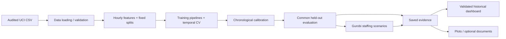

# Technical deep dive

**Anshuman · Bike Sharing Predictive Analysis · November 12, 2026**

This document describes the modular implementation. The [earlier engineering review](TECHNICAL_REVIEW.md) records the original repository inventory, baseline checks, security findings and first round of fixes. The subsequent request explicitly replaced the earlier single-source-file constraint with module separation. The root command and existing notebook imports remain compatible.

## Architecture and responsibilities



| Module / path | Responsibility and test boundary |
|---|---|
| `bike_sharing.py` | Small entry point for CLI and Streamlit; explicitly re-exports notebook APIs |
| `bike_share/config.py` | Fixed feature names, seed, source checksum, staffing assumptions and project location |
| `bike_share/data.py` | Verify source bytes, construct the hourly grid, preserve missing targets; explicit source errors never trigger downloads |
| `bike_share/validation.py` | Explicit shape, finite-value, integer-bound and assumption contracts; no I/O or solver |
| `bike_share/features.py` | Pure calendar/lag construction and deterministic training/calibration/test indices; accepts an explicit source path |
| `bike_share/forecasting.py` | Ridge and boosting pipelines, training-only tuning, MAPIE calibration and 24-hour Python prediction function |
| `bike_share/evaluation.py` | MAE/RMSE, post-prediction slices and fixed point-capacity cost arithmetic |
| `bike_share/optimization.py` | Pure evaluation of saved staffing plans plus lazily imported optional Gurobi solves |
| `bike_share/visualization.py` | EDA, forecast/residual/interval plots, SHAP and business figures; explicit output destination |
| `bike_share/artifacts.py` | Save results to an explicit root and reconcile saved data/costs with the original source before display |
| `bike_share/dashboard.py` | Historical-date/model controls, baseline comparison, intervals, saved staffing plans and downloads |
| `bike_share/documents.py`, `notebooks.py` | Optional report exports and explicit notebook refresh |
| `bike_share/cli.py`, `quality.py` | Command orchestration, pytest adapters and separate check reports; no mutable global output-root switching |
| `tests/` | Pytest fixtures and parameterized tests against module boundaries and saved evidence |
| `benchmarks/browser_flow.py` | Repeatable local Chromium flow measurement; writes into ignored `run_outputs/benchmark` by default |

The model functions receive data explicitly, while I/O functions accept paths. The viewer validates saved evidence and does not call fitting or solver functions. Importing optimization and evaluating saved plans require no Gurobi package. Optional Gurobi imports occur only on solve workflows. This remains a repository-oriented research package, not an installable wheel or a production service.

## Forecasting contract

- Unit: one system-wide hour; target: observed completed rentals (`cnt`).
- Issue time: 11:59 PM on the prior calendar day; predict all 24 next-day hourly slots.
- Data: 17,379 original hourly observations, 17 columns, 2011–2012. Full grid: 17,544 slots; 165 missing hours stay missing.
- Source SHA-256: `e03de4ee4ef4dc376ac6e04bf829673c6269e8eba5c60fa121640fa2f829504f`.
- Features: calendar information, exact 24/48/168-hour lags, seven-day rolling mean/maximum/observed count over `[target−191h, target−24h]`, cyclic hour, commute interaction and calendar trend.
- No contemporaneous target, `casual`, `registered`, or observed target-hour weather enters the model. Observed weather is used only to group errors after prediction.
- Grid validation rejects sparse, duplicated, reversed or timezone-aware input instead of interpreting row offsets as elapsed hours. Source calendar timestamps are treated as a naive hourly grid; an operational timezone/DST policy remains future work.
- Calendar availability and hourly count finalization before issuance are assumptions, not facts established by this historical dataset.

Training starts January 8, 2011 at 23:00 after a 191-hour warm-up and ends October 7, 2012 at 23:00 (15,195 observed targets). Calibration is October 8–November 4 (636 targets). The test is November 5–December 30: eight complete Monday–Sunday weeks. December 31 belongs to an incomplete terminal week and is excluded. Of 1,344 scheduled hours, four have no target and 38 more lack a weekly baseline, leaving 1,302 shared scoring hours. This selection limits the evaluated population.

Ridge uses fixed `alpha=10`, training-only imputation/scaling and one-hot calendar encoding. Boosting retains 220 iterations, no randomized early stopping, seed 835, eight sampled configurations and three expanding time folds with 672-row validation blocks and a 24-row gap. The selected learning rate/leaves/L2 remain 0.08 / 15 / 10. Fitted models stay frozen through calibration/testing; historical test observations update subsequent days’ lags only after observation. The refactor changes software boundaries, not model selection.

MAPIE split conformal calibration remains chronological and prefit, with a 90% nominal level. Saved coverage is 0.8563748079877113 and mean width is 251.41897811767126 rentals. Temporal dependence undermines exchangeability; there is no conditional, station-level or future coverage guarantee. SHAP cases remain selected by low/median/high forecasts, with additivity checked; explanations are not causal effects.

## Optimization contract

For each complete common day, Gurobi selects six integer four-hour shift counts `x[s]`. Each is in `[0,20]`, and `sum(x) <= 48` worker-shift assignments (192 worker-hours). Hourly throughput is `40*x[floor(h/4)]`. Nonnegative shortage/excess variables satisfy:

```text
capacity[h] + shortage[h] - excess[h] = issued_forecast[h]
minimize 80*sum(x) + 5*sum(shortage) + sum(excess)
```

There are 54 variables (six integer), 25 constraints, a 30-second limit, zero MIP gap tolerance, two threads and seed 835. A result is exported only after certified optimality. Shape, finiteness, positive assumptions, integer bounds and budgets are checked before the solver starts. Explicit solver and license failures are distinguished; no substitute solver fabricates a result.

Assumptions: USD 20 hourly wage, 40 rental-service units per worker-hour, USD 5 per shortage unit and USD 1 per excess unit. Only forecasts enter optimization. Actuals evaluate frozen plans afterward. A fixed baseline assigns eight units to each shift. The shared sample is 48 complete days / 1,152 hours; eight partial days are excluded equally. All 144 model-driven solves were reproduced successfully.

Simulated total costs remain fixed $546,974; seasonal naive $401,486; Ridge $372,872; boosting $380,462. Nine sensitivity scenarios revalue these same plans rather than optimize against test actuals. These are retrospective simulations developed after forecast scores were known, not a fresh policy holdout or causal savings. Throughput assignments are not unique staff, bicycles or station inventories, and do not implement breaks, overlap or individual labor rules.

The older point-capacity proxy uses `ceil(max(0, forecast))` on all 1,302 scoring hours. At USD 5 shortage / USD 1 excess, baseline cost is $230,005 and boosting cost is $133,389. Its $96,616 difference is hypothetical; its sample and cost definition differ from the staffing model. Both analyses remain preserved.

## Pytest and licensing separation

```bash
# Core + demo + deterministic model reproduction; no Gurobi installed or licensed.
python -m pip install -r requirements-dev.txt
python -m pytest -m "not gurobi"
python bike_sharing.py --verify

# Optional backend checks, separately installed and executed.
python -m pip install -r requirements-gurobi.txt
python -m pytest -m gurobi

# Full original experiment, isolated outputs.
python bike_sharing.py --data-file data/hour.csv --output-dir run_outputs
```

The current suite contains 41 collected tests: **37 non-Gurobi tests passed in a fresh environment with no solver package**, and **four optional backend tests passed separately**. The `slow` marker identifies deterministic boosting/interval reproduction; `-m "not gurobi and not slow"` runs 36 quick tests. A deselected optional test is not counted as passed. The CLI `--self-test` excludes dashboard tests and dispatches the core files; `--test-demo` runs the five parameterized dashboard cases. Direct pytest is the canonical full-suite command.

Coverage includes exact split boundaries, all lag horizons, rolling-window arithmetic, missing timestamps, future-target/weather perturbation, training-only imputation, all 24 predicted hours across several dates, deterministic repeated Ridge fits, saved Ridge/boosting/interval comparisons, invalid source paths, corrupted saved predictions/plans, report preservation, assertion-disabled execution, staffing feasibility and small-case exhaustive enumeration. The dashboard tests cover selections, incomplete days, fail-closed artifact validation, scenario costs and viewing without even importing Gurobi.

The default CI installs only `requirements-dev.txt`, asserts that `gurobipy` is absent, runs the 37 tests, verifies saved artifacts and checks Git remains unchanged. The optional solver job runs only through manual workflow dispatch with `with_gurobi=true`; a usable license must be available on that runner. No secret license or deployment credential is included, and neither job deploys the app.

## Reproduction findings

Both the modular CLI and the isolated executed notebook were rerun on Linux/Python 3.12.14. The notebook completed all 13 code cells without an error output. Original notebook outputs were preserved; only its bootstrap comment and optional-solver dependency filename changed.

| Evidence | Comparison with original saved experiment |
|---|---|
| `metrics.csv`, `predictions.csv`, `baseline_metrics.csv` | **Byte-for-byte identical** |
| `costs.csv`, `slices.csv`, all five staffing CSVs | **Byte-for-byte identical** |
| `cv_results.csv` | Numerical fields, parameters and ranks exactly equal; fit/score timing columns differ because they measure runtime |
| `summary.json`, `shap_cases.json`, `staffing_summary.json` | Exact parsed JSON equality |
| Original data, result files and existing visualizations | Unmodified; hashes checked against the pre-review inventory |
| Original notebook displayed outputs and execution counts | Unmodified |

Thus the **10.90% Ridge MAE improvement remains the current held-out result**. No discrepancy was hidden by replacing saved values. Fixed seeds and pins support repeatability, but cross-platform bitwise identity is not promised. Windows, hosted Colab and hosted Streamlit were not verified.

## Browser benchmark

Start the local demo in one terminal, then run the repeatable browser flow in another:

```bash
python -m pip install -r requirements-benchmark.txt
python -m playwright install chromium
python benchmarks/browser_flow.py --url http://localhost:8501
```

The script writes screenshots, a selected-day CSV and timing JSON into `run_outputs/benchmark/`. Official Chromium installation may require platform dependencies; follow Playwright’s supported installation instructions rather than disabling TLS checks.

[Recorded samples](demo_benchmark.json): first page ready **5.471 seconds**; five historical-date updates **0.976, 0.958, 1.546, 0.928 and 0.926 seconds**, median **0.958**, maximum **1.546**. The server was already running. Measurements include dropdown interaction and the arrival of the updated dated Plotly chart; they do not include server process startup. This is one local Chromium client, not a concurrent load test, an Internet-latency benchmark or a production SLA. The flow also checked baseline and interval display, staffing selection, CSV download, mobile layout and absence of JavaScript page errors. The published screenshot is an actual capture of that historical flow.

## Security, provenance and unfinished work

The prior review patched Pillow, Tornado and pypdf after a dependency audit; the historical results remained unchanged. The refactor keeps TLS/checksum verification, ignored secret files and read-only verification. A dependency advisory scan is time-bound and does not establish absence of undiscovered vulnerabilities or exploitability. No arbitrary uploads or serialized model loading are exposed by the viewer.

The UCI source retains CC BY 4.0 attribution; Gurobi has separate proprietary terms. No source-code license has been selected. Public repository visibility alone is not a license grant. No proprietary employer data or credentials are included.

Public deployment, hosted Colab, an HTTP prediction API, SQL/Databricks/SAP integration, operational timezone handling, prospective policy validation and production monitoring remain unfinished or outside this project’s scope. They must not be presented as existing capabilities. The model’s historical limitations and the staffing simulation assumptions remain material even when tests pass.
