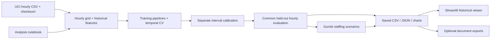

# Technical review — Bike Sharing Predictive Analysis

**Historical review phase:** this document records the initial single-file review. The November 12 follow-up explicitly authorized module separation; see the [current technical deep dive](ARCHITECTURE.md) for the modular implementation, pytest suite, solver-independent CI, exact reproduction findings and measured browser flow.

Review date: November 11, 2026. Baseline commit: `fd105e8e7eebd16401046d27531e1cfcf2d9e4bf`.
Reviewer: OpenAI Codex, supporting Anshuman. Claims below distinguish executed checks from design assumptions. This review preserves the original forecasting experiment, saved outputs, and single-Python-file constraint.

## Baseline inventory and architecture (confirmed before edits)

37 tracked files, one Python source file, one executed notebook, one dependency manifest, and no CI workflow or source-code LICENSE file. All tracked source, documentation, notebook cells, CSV schemas and JSON artifacts were inspected. The working tree was clean and matched GitHub `main` before changes. Public data and saved figures are existing repository assets, not new uploads.

| Files | Role and observations |
|---|---|
| `bike_sharing.py` | 1,107 lines at baseline; one module owns data loading, calendar/lag features, pipelines, chronological tuning, conformal intervals, SHAP, evaluation, plotting, PDF generation, CLI, embedded tests, notebook execution, Gurobi optimization, and Streamlit rendering |
| `analysis.ipynb` | 27 cells: 13 executed code cells and 12 embedded PNG outputs; imports the same Python module; Colab bootstrap clones the current main branch |
| `README.md` | Business problem, chart, metrics, run instructions, split dates, skills, limitations, and AI assistance disclosure |
| `requirements.txt` | 83 exact package pins, including indirect dependencies; Python 3.12 is documented; no hashes or independently verified platform matrix |
| `.gitignore`, `.gitattributes` | Ignore virtual environments, common credentials, caches, archives, model binaries and Gurobi licenses; PDF/PNG marked binary; Streamlit secrets initially omitted |
| `data/hour.csv`, `data/README.md` | Original UCI hourly data (1,156,736 bytes), citation and SHA-256; 17,379 rows × 17 columns; 165 missing hours on the full timeline |
| `results/baseline_metrics.csv`, `metrics.csv`, `predictions.csv`, `cv_results.csv`, `summary.json` | Baseline and model scores, 1,302 aligned test predictions, eight tuning candidates, chronology and calibration audit |
| `results/costs.csv`, `slices.csv`, `shap_cases.json` | Nine fixed-capacity cost scenarios, 99 model/error-slice rows, three SHAP explanations |
| `results/staffing_daily.csv`, `staffing_hourly.csv`, `staffing_metrics.csv`, `staffing_plans.csv`, `staffing_sensitivity.csv`, `staffing_summary.json` | 192 policy-days, 4,608 policy-hours, four policy totals, 1,152 shift assignments, 36 fixed-plan sensitivity rows, solver/assumption audit |
| `results/safety_tests.json`, `verification.json` | Historical saved verification evidence, not proof that a future edit passes tests |
| `visualizations/actual_vs_predicted.png`, `baseline_week.png`, `baseline_residuals.png`, `eda.png`, `residuals.png`, `intervals.png`, `sliced_errors.png` | Existing forecast and diagnostic figures |
| `visualizations/shap_low.png`, `shap_moderate.png`, `shap_high.png`, `business_costs.png`, `staffing_optimization.png`, `staffing_interactive.html` | Explanations and business scenarios; HTML embeds Plotly JavaScript (4,828,383 bytes) for offline use |

No tracked reports directory remains; its earlier deletion is preserved. Reports are optional local exports. No SQL, Spark, Databricks, SAP, serving API, database, or employer dataset is implemented. The large notebook and HTML are existing presentation artifacts; no new large dataset is needed.

Entry points: `python bike_sharing.py` (full analysis, default `run_outputs/`); `--self-test`; `--verify`; `--execute-notebooks`; `--build-documents`; `--demo`; and `python -m streamlit run bike_sharing.py`. `forecast_day()` is a Python function, not an HTTP service. The notebook calls the same functions and deliberately writes refreshed outputs when executed.

## Baseline checks (executed before edits)

- Python **3.12.14**. `python -m pip check`: no broken requirements.
- `python bike_sharing.py --self-test`: **17 passed, 0 failed, 0 errors, 0 skipped**.
- `python bike_sharing.py --verify`: passed; 13 executed notebook cells, 12 PNG outputs; optional PDFs absent; 1,302 scored hours; 144 saved optimal solves across 48 complete days; one Python source file.
- Current tracked-text heuristic credential scan: no private-key, common GitHub/AWS token, or quoted-secret-assignment patterns found. No secret values were printed. This is not an exhaustive scan, history review, dependency-vulnerability clearance, or security certification.
- Audited raw data checksum: `e03de4ee4ef4dc376ac6e04bf829673c6269e8eba5c60fa121640fa2f829504f`.
- All tracked files were hashed outside the repository before editing, to check preservation afterward.
- A nonfatal Fontconfig cache warning appeared in the baseline run; tests still passed.

## README claims checked against evidence

| Claim | Assessment |
|---|---|
| Ridge MAE 64.10, baseline 71.95, boosting 69.30; Ridge improves MAE 10.90% | **Confirmed** by recomputing saved predictions; full rerun is a separate verification step |
| 90% nominal intervals achieved 85.64% coverage | **Confirmed** from saved bounds and actuals; exchangeability and future coverage are not established |
| Training/calibration/test are chronological and preprocessing is training-only | **Confirmed** by source inspection and existing perturbation/imputation tests |
| Gurobi produced 144 optimal solves and Ridge scenario cost $372,872 | **Confirmed** from saved certificates and cost arithmetic; historical certificates are not independently rerun solves |
| No Gurobi license is needed to view saved results | Source has no viewer solver call; verify again through automated demo tests |
| Colab and public Streamlit deployment work | **Unfinished**: README already states hosted Colab was not tested and no public demo URL exists |
| Current staffing policy, throughput, wages and penalty costs represent real operations | **Assumptions**, explicitly hypothetical; this dataset has no staffing, station inventory, or unmet-demand measurements |
| Counts are finalized at 11:59 PM; holiday information is known before issuance | **Operational assumptions**; source data do not establish reporting latency |
| No test-informed feature choice occurred | Stated experimental design; current files alone cannot independently establish all historical design decisions |

## Confirmed issues and prioritized plan

| Priority | Finding and proposed change | Complexity / trade-off |
|---|---|---|
| P0 | Explicit nonexistent `--data-file` silently downloads instead of failing; an existing destination can hide an invalid explicit input. Validate explicit input first. | Small; implicit download remains available, explicit errors become visible |
| P0 | `staffing_cost(10, zeros(6))` silently broadcasts a scalar over 24 hours. NaN/infinite solver assumptions pass positivity checks and are mislabeled as license failures. Validate shape, finiteness, integer assignments, bounds and assumptions. | Moderate; valid recorded solves remain unchanged |
| P0 | Saved artifact checks lack source-aligned timestamp/actual checks and complete unique policy/shift keys; demo can crash or display inconsistent tables. Add a shared explicit validation boundary before display. | Moderate; modest extra local validation cost, no new model fitting |
| P0 | Python `-O` removes assertion checks. Refuse optimized execution for test/verification entry points. Ignore `.streamlit/secrets.toml`. | Small; fail clearly instead of falsely reporting success |
| P0 | A dependency audit found 50 advisory entries across Pillow 12.3.0 (40), Tornado 6.5.10 (3), and pypdf 6.21.2 (7). Upgrade to Pillow 13.0.0, Tornado 6.6 and pypdf 6.21.4, then rerun the analysis and UI checks. | Moderate; Pillow is a major-version change, so regenerated images/PDFs and the viewer require validation; exposure to every advisory is not assumed |
| P1 | Running checks rewrites historical tracked JSON; new tests cannot be represented honestly by a hard-coded old test count. Make checks read-only by default, optionally save a new report separately, distinguish historical evidence. | Moderate; existing evidence remains intact |
| P1 | No committed demo regression tests or CI; dependency installation was only established in a long-lived environment. Add embedded regression tests, separate demo-test action, CI configuration, clean installation and isolated full rerun. | Moderate; one Python file retained; CI service execution must be observed separately |
| P2 | Missing explicit architecture/role mapping; source-code reuse rights unspecified; data license not named. Add this review, accurate capability mapping, public-source license citation, and browser evidence. | Small–moderate; do not choose a source-code license on the author's behalf |
| P3 | Optional SQL staging/quality checks, Databricks ETL, SAP extracts, model-serving API, newer data, prospective policy evaluation. | Large / future scope; each requires its own data contract, access, tests and validation; not implemented in this review |

## Licensing and security boundaries

UCI's dataset page was retrieved during this review and links **CC BY 4.0** (`https://creativecommons.org/licenses/by/4.0/legalcode`). Keep attribution and note modifications when redistributing data. Gurobi is proprietary software with separate license terms; successful small-model execution here does not grant general deployment rights. No source-code LICENSE file exists; public GitHub visibility does not itself grant an open-source license. Selecting one remains the author's decision.

The dataset contains aggregate hourly counts, dates, and environmental/calendar variables, not personal trip identifiers. No proprietary employer data was found in the current tracked inventory. Download TLS verification and the fixed data checksum are retained. Dependencies and the existing embedded JavaScript remain supply-chain inputs. No arbitrary model pickle loading, public upload endpoint, or shell interpolation of user input was found. Review scope does not include a complete audit of Git history or every third-party dependency's source.

## Implementation completed

1. **Input and artifact contracts (`bike_sharing.py`, `.gitignore`).** Explicit source paths now fail when absent or altered, even if an output cache exists. Features reject sparse, duplicated, reversed or timezone-aware grids rather than interpreting row offsets as hours. Staffing evaluation requires 24 finite nonnegative values, six feasible integer shift counts, and finite positive assumptions. Invalid input is rejected before Gurobi starts; license errors are distinguished from other solver failures. A shared read-only loader validates source-aligned predictions, metrics, intervals, unique complete policy/shift keys, component costs, solver certificates and aggregates before demo display. Verification additionally reconciles hourly capacities and both sensitivity exports. Streamlit secrets are ignored.
2. **Regression coverage and check semantics (`bike_sharing.py`, CI workflow).** The original 17 tests are retained, with ten new core regression checks and four demo tests. Optimized Python execution is refused for checks so assertions cannot silently disappear. Test/verification commands no longer write into historical `results/`; an explicit new `--report-file` is optional and cannot overwrite protected evidence. The CI workflow uses pinned action revisions, Python 3.12, read-only contents permission and no deployment step.
3. **Dependency fixes (`requirements.txt`).** Only the three affected pins changed. The final environment resolves all 83 pins without dependency conflicts. Tools used only for this review (pip-audit and Playwright) were installed outside the repository and are not production requirements.
4. **Demo and documentation (`bike_sharing.py`, README, source attribution, this review).** Missing/inconsistent inputs stop the viewer before metrics appear. The interval caption derives coverage from validated output. CSV download avoids a rerun. Bare module strings and a conditional expression no longer appear as stray text/`None` through Streamlit magic. Currency assumptions use USD labels instead of accidental Markdown math. Role mapping separates implemented ML/optimization/data-contract evidence from future SQL/Databricks/SAP work. UCI's CC BY 4.0 attribution and the unresolved source-code license are explicit.

## Commands and observed results

Commands below were run from the repository root. The clean interpreter was `/tmp/bike-review-clean/bin/python`; substitute your activated Python 3.12 environment. Logs and browser screenshots were retained under `/tmp/bike-review-*` in this workspace, not added to Git. New check reports used unique `/tmp/` paths. Initial tests used the original `.venv` before edits.

| Command/check | Observed result |
|---|---|
| `python --version`; `python -m pip check` (baseline) | Python 3.12.14; no broken requirements |
| `python bike_sharing.py --self-test` (before edits) | 17 passed, 0 failed/errors/skipped |
| `python bike_sharing.py --verify` (before edits) | Passed on existing saved evidence; optional PDF absence reported accurately |
| `python -m venv /tmp/bike-review-clean`; fresh-environment `python -m pip install -r requirements.txt` | All 83 original pins installed from scratch; patched requirements subsequently installed into that fresh environment; `pip check` passed |
| `python bike_sharing.py --self-test --report-file /tmp/bike-review-release-tests.json` | 27 core tests passed, including original 17; no skipped checks |
| `python bike_sharing.py --test-demo --report-file /tmp/bike-review-release-demo-tests.json` | Four demo tests passed: controls/gaps, staffing/costs, fail-closed missing/corrupt data, and no solver-license request |
| `python bike_sharing.py --verify --report-file /tmp/bike-review-release-verification.json` | Saved artifact reconciliation passed; historical test JSON is identified as historical evidence, not current test execution |
| `python bike_sharing.py --data-file data/hour.csv --output-dir /tmp/bike-review-reproduction` | Full analysis with original dependency pins completed; matches saved numerical outputs |
| `python bike_sharing.py --data-file data/hour.csv --output-dir /tmp/bike-review-patched-reproduction` | Full analysis with patched pins completed; includes model fitting, SHAP, intervals, all 144 Gurobi solves, charts and PDFs |
| Independent pandas/JSON comparison of both reruns | Eleven CSV outputs match within `rtol=atol=1e-10`; only nondeterministic CV timing columns excluded. Three analytical JSON outputs match exactly. Optional exports remain two memo pages and ten slides |
| `pip-audit -r requirements.txt --no-deps --disable-pip --format json` (pip-audit 2.10.1, separate tools environment) | Baseline: 50 advisory entries in three packages. After patches: **0 known advisories across 83 assessed pins**, no skipped packages. This is the service's current result, not a guarantee against undiscovered issues or an exploitability assessment |
| `python -m streamlit run bike_sharing.py --server.headless true --server.address 127.0.0.1 --server.port 8501 --browser.gatherUsageStats false` | Local server served HTTP 200. It was used only for local review, not publicly deployed |
| Playwright 1.65.1 / Chromium browser checks | Forecast selection, interval display, CSV download and staffing selection passed; downloaded CSV matches the selected day exactly; no page JavaScript errors. Desktop (1440×1000) and mobile (390×844) screenshots inspected |
| SHA-256 comparison against pre-edit inventory | **All 31 protected original files** (data CSV, executed notebook, saved results and visualizations) are byte-for-byte unchanged |
| Markdown link checks; `git diff --check`; `git check-ignore .streamlit/secrets.toml` | Passed |

The initial dependency-audit attempt hit a read-only default cache directory; rerunning with `XDG_CACHE_HOME=/tmp/bike-review-cache` completed. An initial browser sequence timed out on a dropdown after prior interactions; isolated staffing navigation and the repeated browser checks succeeded. Screenshots also exposed the stray module text and `None` display that were corrected. No failed attempt is represented as a successful check.

The phase-one [GitHub Actions run](https://github.com/agrawalanshuman/Bike_Sharing_Predictive_Analysis/actions/runs/43125712552) completed successfully for commit `6b0979dd0db2b9219c4048453d4c8316e93c3fde`. This verifies that reviewed single-file revision; the later modular workflow is a separate revision. Neither run grants or performs deployment approval.

## Preserved observations and limitations

- Baseline / Ridge / boosting MAE remain **71.948541 / 64.104873 / 69.304928 rentals per hour**. Ridge's MAE reduction is **10.901775%**. These are historical held-out measurements, not production performance.
- Interval coverage remains **0.8563748079877113**, below the 0.9 nominal target. Mean width remains 251.41897811767126 rentals.
- The staffing comparison still uses **48 complete days / 1,152 hours** with **144 optimal model-based solves**. Fixed / seasonal / Ridge / boosting hypothetical costs remain **$546,974 / $401,486 / $372,872 / $380,462**.
- The demo is a saved historical-results viewer. **Public hosting and Google-hosted Colab are unfinished/unverified.** No production or public deployment was performed.
- Reporting latency, staffing throughput, wage/penalty assumptions, labor rules and future generalization need operational evidence. No station inventories or unmet-demand observations are present. The retrospective optimization extension is not a fresh policy holdout.
- Runtime validation is deliberately tied to this audited experiment; it is not a general ingestion service for arbitrary datasets. The single-file architecture satisfies the project constraint but couples plotting, modeling, tests and UI imports. Modular packaging is a future trade-off if that constraint changes.
- Testing covers Linux/Python 3.12.14 locally. Windows, other Python versions, hosted Colab and hosted Streamlit are not established by these runs. The phase-one remote CI result is linked above. Colab clones moving `main`, so a commit-pinned environment would improve repeatability.
- Package versions are pinned but artifacts are not hash-locked; audit findings can change over time. The fixed HTTPS download is checksum-verified, but transport/decompression size limits are not implemented. Current tracked-file credential scanning is heuristic and does not audit all historical commits or third-party source code.
- No source-code license was selected. SQL/Databricks/SAP integrations, an HTTP inference API, model registry, production monitoring and prospective business validation remain optional future work, not portfolio claims.

## Interview-ready summary

“I built a reproducible next-day demand forecasting and capacity-planning project using public bike-sharing data. I compared a same-hour-last-week benchmark, Ridge and tuned boosting with chronological validation and explicit leakage controls. Ridge reduced held-out MAE by 10.9%. I connected forecasts to a Gurobi staffing scenario, documented uncertainty and cost assumptions, and built a historical Streamlit viewer. The engineering work includes input contracts, artifact reconciliation, 27 core tests, four UI tests, dependency auditing and CI configuration. The operating costs are hypothetical, and a prospective pilot is still required.”

